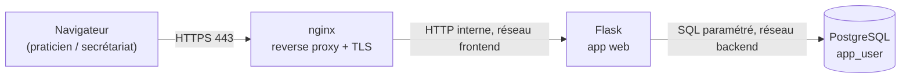

# Portail web + base de données — Cabinet médical (Medical Office)

Ta partie du projet final Jedha : serveur web + base de données, sécurisés dès le départ
plutôt qu'en rattrapage. Tout tourne en conteneurs Docker, comme prévu dans le cadrage.

## Vue d'ensemble



- **nginx** est le seul conteneur exposé sur l'hôte (ports 80/443). Il termine le TLS et
  redirige tout le HTTP vers HTTPS.
- **Flask** n'est joignable que depuis nginx (réseau Docker `frontend`), jamais directement
  depuis l'extérieur.
- **PostgreSQL** n'est joignable que depuis l'appli (réseau Docker `backend`), jamais depuis
  l'extérieur ni depuis nginx.

## Pourquoi ces choix (à réutiliser dans ton doc de spec / ton rapport)

| Risque classique | Ce qui l'évite ici |
| --- | --- |
| Injection SQL | Toutes les requêtes utilisent des paramètres (`%s`), jamais de concaténation de l'input utilisateur |
| XSS | Auto-échappement des templates Jinja2 (activé par défaut dans Flask) |
| CSRF | `Flask-WTF` génère et vérifie un jeton CSRF sur chaque formulaire |
| Mots de passe en clair / faibles | Hash bcrypt (coût 12), jamais stocké ni loggé en clair |
| Secrets dans le code | Tout vient de `.env` (jamais commité), l'app refuse de démarrer si une variable manque |
| Compte DB trop privilégié | L'appli utilise `app_user` (SELECT/INSERT/UPDATE/DELETE seulement), jamais le compte superuser d'init |
| Interception réseau | TLS obligatoire, HTTP redirigé, HSTS |
| Élévation horizontale/verticale dans l'appli | RBAC simple : seul le rôle `medecin` peut supprimer un dossier patient |

C'est volontairement un point de départ correct, pas un audit complet — le but est justement
que vous (ou l'équipe qui vous teste en Mission II) trouviez ce qu'il manque encore
(rate limiting, verrouillage de compte après échecs répétés, 2FA, logs vers Wazuh, etc.).

## Déploiement (sur une VM Linux avec Docker installé)

1. **Copier ce dossier** sur la VM prévue dans la "zone serveurs" du schéma réseau (celle qui
   accueillera aussi la BDD et, plus tard, le monitoring).

2. **Configurer les secrets** :
   ```bash
   cp .env.example .env
   openssl rand -hex 32   # à coller dans FLASK_SECRET_KEY
   # édite .env et remplace toutes les valeurs "change_me_*"
   ```

3. **Générer un certificat TLS de lab** (auto-signé — à remplacer par un vrai certificat si ça
   sort un jour du contexte du lab) :
   ```bash
   ./nginx/generate-cert.sh
   ```

4. **Construire et lancer** :
   ```bash
   docker compose build
   docker compose up -d
   ```

5. **Créer les comptes du personnel** (une seule fois) :
   ```bash
   docker compose exec app python seed.py
   ```

6. **Tester** : `https://<ip-de-la-vm>/` — le navigateur va avertir à cause du certificat
   auto-signé, c'est normal en lab (accepte l'exception). Connecte-toi avec le compte
   `SEED_ADMIN_USER` / `SEED_ADMIN_PASSWORD` défini dans `.env`.

## Intégration dans GNS3

Le plus simple : une VM (QEMU, VMware, ou VirtualBox selon ton lab) avec Docker installé,
ajoutée comme nœud dans ta topologie GNS3, reliée à la zone "serveurs" définie dans le
cadrage. Docker n'a pas besoin de tourner *dans* GNS3 — GNS3 route le réseau, la VM fait le
travail. Vérifie juste que la VM peut sortir sur Internet le temps du `docker compose build`
(pour télécharger les images), avant de la brancher dans le zonage final avec firewall.

## Pour la suite (à articuler avec le reste de l'équipe)

- Brancher les logs applicatifs (déjà loggés sur stdout : connexions réussies/échouées,
  créations/suppressions de patients) dans Wazuh dès que la brique monitoring est prête.
- Restreindre l'accès réseau à nginx (443) depuis le firewall périmètre, pas de règle "allow
  all" vers la zone serveurs.
- Une fois l'AD en place, discuter avec l'équipe si l'authentification du personnel doit rester
  locale (comme ici) ou être déléguée à l'AD (LDAP) — c'est un bon sujet pour le document de
  spécification technique et pour la veille technologique.
- Garder une trace des étapes de configuration au fur et à mesure : ça te fera gagner du temps
  pour rédiger le document de spécification technique et pour ton propre rapport si tu dois
  documenter cette brique en détail.
