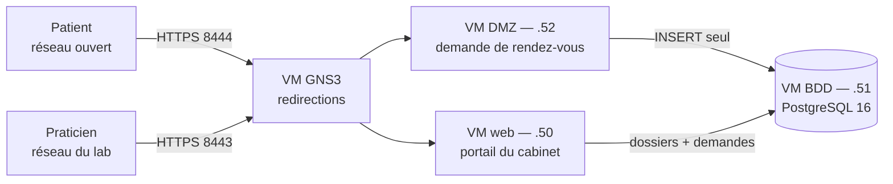

# Cabinet médical — portail interne et prise de rendez-vous

Brique « serveur web et base de données » de l'infrastructure du projet final Jedha,
profil *Medical Office*. Deux applications distinctes, trois machines, trois niveaux de
confiance.

## Architecture



| Machine | Adresse | Rôle | Compte PostgreSQL |
| --- | --- | --- | --- |
| `dmz-rdv` | 192.168.122.52 | Formulaire public de demande de rendez-vous | `booking_user` — `INSERT` sur une table |
| `web-medical` | 192.168.122.50 | Portail du personnel : dossiers patients, traitement des demandes | `app_user` — lecture/écriture sur trois tables |
| `db-medical` | 192.168.122.51 | PostgreSQL 16, aucun autre service | superuser, joignable en local uniquement |

Le principe qui structure l'ensemble : **plus un service est exposé, moins il peut faire**.
Le site public, accessible à n'importe qui, ne peut qu'écrire des demandes de rendez-vous
et ne sait rien relire — pas même ce qu'il vient d'écrire. Le portail du personnel,
accessible après authentification, manipule les dossiers. La base, elle, ne parle qu'à ces
deux machines et son compte d'administration n'est joignable que depuis la machine
elle-même.

Accès depuis le réseau du lab, par redirection sur la VM GNS3 :
`https://192.168.183.147:8443` pour le portail, `:8444` pour le site patients.

## Mesures de sécurité

### Communes aux deux applications

| Risque | Mesure |
| --- | --- |
| Injection SQL | Requêtes paramétrées exclusivement |
| XSS | Auto-échappement Jinja2 |
| CSRF | Jeton vérifié sur chaque formulaire |
| Écoute réseau | TLS obligatoire, HTTP redirigé, HSTS |
| Divulgation | `server_tokens off`, en-têtes de sécurité portés par nginx seul |
| Secrets dans le code | Tout dans `.env`, exclu du dépôt, démarrage refusé si une variable manque |
| Accès direct à la base | `pg_hba.conf` par rôle et par adresse, plus filtrage `DOCKER-USER` sur le port 5432 |

### Portail du personnel

Mots de passe hachés en bcrypt coût 12. Cookies `Secure`, `HttpOnly`, `SameSite=Lax`.
Limitation à cinq tentatives de connexion par minute et par adresse. Rôles `medecin` et
`secretaire`, la suppression d'un dossier étant réservée au médecin. Chaque traitement de
demande enregistre son auteur et son horodatage.

### Site public

Rôle PostgreSQL en écriture seule sur une seule table : aucune lecture possible, sur
aucune table. Champ piège invisible contre les robots et limitation à deux envois par
minute et par adresse. Corps de requête plafonné à 32 ko, date bornée à 90 jours,
longueurs contraintes. `Content-Security-Policy` sans aucun script autorisé. Référence de
demande tirée au hasard et non séquentielle, pour empêcher toute énumération.

**Aucun compte patient** : le formulaire est anonyme et le cabinet rappelle. Il n'y a donc
ni base de mots de passe patients à protéger, ni réinitialisation à sécuriser, ni
énumération de comptes possible.

**Aucune donnée médicale collectée** : nom, contact, date et demi-journée souhaitées, et un
champ de précisions pratiques plafonné avec avertissement. Le formulaire public reste
hors du périmètre des données de santé.

## Déploiement

Les trois machines sont des nœuds Debian 12 de la topologie GNS3. Le script
`db-vm/provision-debian.sh` prépare une machine neuve — nom d'hôte, adresse statique,
DNS, neutralisation de cloud-init, Docker. Son en-tête documente les étapes préalables.

Deux précautions apprises à nos dépens : vérifier `hostname` avant toute commande
privilégiée, et poser `preserve_hostname: true` dans `/etc/cloud/cloud.cfg.d/`, faute de
quoi cloud-init réécrit le nom de la machine au redémarrage suivant.

### 1. Base de données — 192.168.122.51

```bash
cd db-vm
cp .env.example .env          # les quatre valeurs, APP_ALLOWED_CIDR, BOOKING_DB_PASSWORD
docker compose up -d
./002-appointments.sh         # table des demandes et rôle booking_user
./protect-db.sh               # port 5432 réservé aux deux machines applicatives
```

Le script d'initialisation ne s'exécute qu'au premier démarrage du conteneur : le `.env`
doit être définitif avant le premier `up`.

### 2. Portail du personnel — 192.168.122.50

```bash
cp .env.example .env          # mêmes identifiants de base, DB_HOST=192.168.122.51
./nginx/generate-cert.sh
docker compose build && docker compose up -d
docker compose exec app python seed.py
```

### 3. Site public — 192.168.122.52

```bash
cd booking-vm
cp .env.example .env          # DB_PASSWORD = BOOKING_DB_PASSWORD de la VM base
./nginx/generate-cert.sh
docker compose build && docker compose up -d
```

### 4. Publication sur le réseau du lab

Le script `gns3/publish-portal.sh` pose les deux redirections, 8443 vers le portail et
8444 vers le site public, sans masquage : les adresses sources réelles restent visibles
dans les journaux, ce qui est nécessaire à la limitation par adresse et à l'analyse des
accès.

## Exploitation

```bash
docker compose down     # jamais -v : le volume contient les données
docker compose up -d
```

Les conteneurs redémarrent seuls avec leur machine. Les règles iptables, non : rejouer
`db-vm/protect-db.sh` sur la base et `gns3/publish-portal.sh` sur la VM GNS3 après chaque
redémarrage.

Sauvegarde :

```bash
docker compose exec -T db pg_dump -U postgres_admin medical_office > dump-$(date +%F).sql
```

## Vérifications

Le parcours complet : déposer une demande sur `:8444`, noter la référence, la retrouver
sur `:8443/rendez-vous` et la confirmer.

Le cloisonnement, depuis la VM DMZ — la vérification la plus parlante du projet :

```bash
docker compose exec app python -c "
import os, psycopg2
c = psycopg2.connect(host=os.environ['DB_HOST'], dbname=os.environ['DB_NAME'],
                     user=os.environ['DB_USER'], password=os.environ['DB_PASSWORD'])
cur = c.cursor()
for table in ('patients', 'staff', 'appointments'):
    try:
        cur.execute(f'SELECT count(*) FROM {table}')
        print(table, '-> lecture AUTORISEE :', cur.fetchone()[0])
    except Exception as e:
        print(table, '-> refuse :', str(e).strip().splitlines()[0])
    c.rollback()
"
```

Les trois tables doivent être refusées. Le filtrage réseau se vérifie de la même façon
depuis une machine tierce : `nc -vz 192.168.122.51 5432` depuis la VM GNS3 ne doit pas
aboutir.

## Limites connues

Assumées et documentées plutôt que masquées.

Les certificats TLS sont auto-signés. La liaison entre les applications et la base n'est
pas chiffrée : acceptable sur un segment contrôlé, à corriger en contexte réel de données
de santé. L'authentification du personnel est locale et sans second facteur, en attendant
une délégation à l'annuaire. La limitation de débit freine le bruteforce mais ne verrouille
pas les comptes. Les secrets vivent dans des fichiers `.env` sur disque et non dans un
coffre. La purge des demandes de plus de six mois, annoncée aux patients, n'est pas encore
automatisée. Le champ de précisions du formulaire public est libre : seul un avertissement
dissuade d'y écrire une information médicale, là où une liste de choix l'interdirait. Enfin
les journaux, bien qu'écrits sur la sortie standard et prêts à être collectés, ne sont pas
encore repris par la brique monitoring.

L'image Debian du template GNS3 embarque par ailleurs des clés d'hôte SSH pré-générées,
identiques sur toute machine qui en dérive. Le script de provisionnement les régénère, ce
qui referme une possibilité d'usurpation entre machines du lab.

## Arborescence

```
.
├── app/                    Portail du personnel (Flask, templates, seed)
├── nginx/                  Reverse proxy du portail
├── booking-vm/             Site public de prise de rendez-vous, machine DMZ
│   ├── app/
│   ├── nginx/
│   └── docker-compose.yml
├── db-vm/                  Machine base de données
│   ├── docker-compose.yml
│   ├── 001-init.sh         Schéma, rôle app_user, restriction pg_hba
│   ├── 002-appointments.sh Table des demandes, rôle booking_user
│   ├── protect-db.sh       Filtrage du port 5432
│   └── provision-debian.sh Préparation d'une machine neuve
├── docker-compose.yml      Pile du portail
└── .env.example
```

Les fichiers `.env`, certificats, clés et dumps ne sont jamais versionnés.
