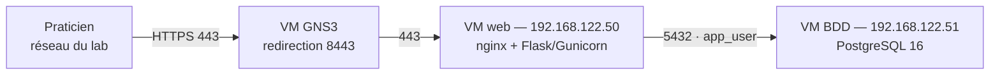

# Portail interne — Cabinet médical

Brique « serveur web + base de données » de l'infrastructure du projet final Jedha,
profil *Medical Office*. Portail de consultation des dossiers patients, déployé en
conteneurs sur deux machines distinctes.

## Architecture



Le serveur web et la base sont **sur deux machines séparées**. Le serveur web est le seul
à être joignable depuis le réseau ; la base n'accepte qu'une seule adresse source, un seul
rôle et une seule base de données. Un compromis du portail ne donne donc pas un accès
administrateur aux données de santé.

| Machine | Adresse | Rôle | Ports exposés |
| --- | --- | --- | --- |
| `web-medical` | 192.168.122.50 | nginx (terminaison TLS, reverse proxy) + application Flask | 80, 443 |
| `db-medical` | 192.168.122.51 | PostgreSQL 16 | 5432, sur cette seule adresse |

L'accès depuis le réseau du lab passe par une redirection de port sur la VM GNS3 :
`https://192.168.183.147:8443`.

## Mesures de sécurité

| Risque | Mesure en place |
| --- | --- |
| Injection SQL | Requêtes paramétrées exclusivement, aucune concaténation d'entrée utilisateur |
| XSS | Auto-échappement Jinja2 |
| CSRF | Jeton vérifié sur chaque formulaire (Flask-WTF) |
| Vol de session | Cookies `Secure`, `HttpOnly`, `SameSite=Lax`, clé de signature issue de `.env` |
| Mots de passe | Hachage bcrypt coût 12, jamais stockés ni journalisés en clair |
| Bruteforce | Limitation nginx sur `/login` : 5 requêtes par minute et par IP, rafale de 5 |
| Écoute réseau | TLS obligatoire, HTTP redirigé, HSTS 2 ans |
| Fuite d'information | `server_tokens off`, en-têtes `X-Frame-Options`, `X-Content-Type-Options`, `Referrer-Policy` |
| Élévation de privilèges applicative | Rôles `medecin` / `secretaire`, suppression d'un dossier réservée au médecin |
| Compromission du serveur web | Base sur une machine distincte, compte superuser injoignable depuis le réseau |
| Accès direct à la base | `pg_hba.conf` limité à `app_user` depuis 192.168.122.50, plus filtrage `DOCKER-USER` sur le port 5432 |
| Privilèges excessifs en base | `app_user` dispose de SELECT/INSERT/UPDATE/DELETE sur deux tables, rien de plus |
| Secrets dans le code | Toutes les valeurs sensibles dans `.env`, exclu du dépôt ; l'application refuse de démarrer si une variable manque |

Les journaux applicatifs (connexions réussies et échouées, créations et suppressions de
dossiers) sont écrits sur la sortie standard, prêts à être collectés par la brique
monitoring.

## Déploiement

Les deux machines sont des nœuds Debian 12 dans la topologie GNS3, reliés au même switch
que le nœud NAT. Le script `db-vm/provision-debian.sh` prépare une machine neuve : nom
d'hôte, adresse statique persistante, DNS, neutralisation de cloud-init, Docker. Son
en-tête documente les étapes préalables, dont l'agrandissement du disque.

### 1. Base de données (192.168.122.51)

```bash
cd db-vm
cp .env.example .env          # renseigner les quatre valeurs et APP_ALLOWED_CIDR
docker compose up -d
docker compose logs db | tail -5
./protect-db.sh               # filtrage du port 5432
```

Le script d'initialisation crée le schéma, le rôle `app_user` et réécrit `pg_hba.conf`.
Il ne s'exécute qu'au tout premier démarrage : les valeurs du `.env` doivent donc être
définitives avant le premier `up`.

### 2. Serveur web (192.168.122.50)

```bash
cp .env.example .env          # mêmes DB_NAME / DB_USER / DB_PASSWORD, plus DB_HOST=192.168.122.51
./nginx/generate-cert.sh
docker compose build
docker compose up -d
docker compose exec app python seed.py
curl -k https://localhost/ | head -5
```

### 3. Publication sur le réseau du lab

Sur la VM GNS3, redirection du port 8443 vers le serveur web :

```bash
sudo sysctl -w net.ipv4.ip_forward=1
sudo iptables -t nat -A PREROUTING -d 192.168.183.147 -p tcp --dport 8443 \
     -j DNAT --to-destination 192.168.122.50:443
sudo iptables -I FORWARD -d 192.168.122.50 -p tcp --dport 443 -j ACCEPT
```

Aucune règle de masquage : les adresses sources réelles restent visibles dans les journaux
nginx, ce qui est nécessaire à la limitation par IP et à l'analyse des accès.

## Exploitation

Arrêt et redémarrage de la pile, sur chaque machine :

```bash
docker compose down     # jamais -v : le volume contient les données
docker compose up -d
```

Les conteneurs sont en `restart: unless-stopped` et repartent seuls au démarrage de la
machine. Les règles iptables, en revanche, ne survivent pas à un redémarrage : rejouer
`db-vm/protect-db.sh` sur la base, et la redirection ci-dessus sur la VM GNS3.

Sauvegarde de la base :

```bash
docker compose exec -T db pg_dump -U postgres_admin medical_office > dump-$(date +%F).sql
```

Le fichier doit être rapatrié hors de l'infrastructure. Les dumps sont exclus du dépôt.

## Limites connues

Elles sont assumées et documentées plutôt que masquées.

Le certificat TLS est auto-signé, adapté au lab mais pas à une exploitation réelle. La
liaison entre l'application et la base n'est pas chiffrée : acceptable ici car les deux
machines sont sur un segment contrôlé, à corriger en contexte de données de santé réel.
L'authentification du personnel est locale et sans second facteur, en attendant une
éventuelle délégation à l'annuaire. La limitation de débit freine le bruteforce mais ne
verrouille pas les comptes après une série d'échecs. Les secrets vivent dans un fichier
`.env` sur disque et non dans un coffre. Enfin, les journaux ne sont pas encore collectés
par la brique monitoring.

## Arborescence

```
.
├── app/                    Application Flask (code, templates, Dockerfile, seed)
├── nginx/                  Configuration du reverse proxy et génération du certificat
├── db-vm/                  Tout ce qui concerne la machine base de données
│   ├── docker-compose.yml
│   ├── 001-init.sh         Schéma, rôle applicatif, restriction pg_hba
│   ├── protect-db.sh       Filtrage du port 5432
│   └── provision-debian.sh Préparation d'une machine Debian neuve
├── docker-compose.yml      Pile du serveur web (app + nginx)
└── .env.example            Variables attendues, sans aucune valeur
```

Les fichiers `.env`, les certificats, les clés et les dumps ne sont jamais versionnés.
