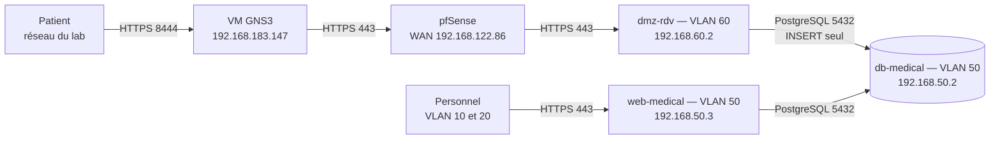

# Cabinet médical — portail interne et prise de rendez-vous

Brique « serveur web et base de données » de l'infrastructure du projet final Jedha,
profil *Medical Office*. Deux applications distinctes, trois machines, trois niveaux de
confiance, réparties dans les VLAN de l'infrastructure et filtrées par pfSense.

## Architecture



| Machine | VLAN | Adresse | Rôle | Compte PostgreSQL |
| --- | --- | --- | --- | --- |
| `dmz-rdv` | 60 | 192.168.60.2 | Formulaire public de demande de rendez-vous | `booking_user` — `INSERT` sur une table |
| `web-medical` | 50 | 192.168.50.3 | Portail du personnel : dossiers patients, traitement des demandes | `app_user` — lecture/écriture sur trois tables |
| `db-medical` | 50 | 192.168.50.2 | PostgreSQL 16, aucun autre service | superuser, joignable en local uniquement |

Masque `/24`, passerelle `.1` de chaque VLAN (pfSense). Les adresses sont fixes sur les
machines et réservées par adresse MAC dans le DHCP de pfSense : les deux configurations
disent la même chose.

Le principe qui structure l'ensemble : **plus un service est exposé, moins il peut faire**.
Le site public, accessible à n'importe qui, ne peut qu'écrire des demandes de rendez-vous
et ne sait rien relire, pas même ce qu'il vient d'écrire. Le portail du personnel,
joignable seulement depuis les VLAN du personnel et après authentification, manipule les
dossiers. La base ne parle qu'à ces deux machines, et son compte d'administration n'est
joignable que depuis la machine elle-même.

Accès :

- site public : `https://192.168.183.147:8444/` depuis le réseau du lab ;
- portail : `https://192.168.50.3/` depuis les VLAN 10 et 20 uniquement. Il n'est pas publié.

## Flux autorisés

| Source | Destination | Port | Filtrage |
| --- | --- | --- | --- |
| Lab | VM GNS3 `192.168.183.147` | 8444 | Redirection vers le WAN de pfSense (`gns3/publish-portal.sh`) |
| WAN pfSense | `192.168.60.2` | 443 | Redirection pfSense |
| VLAN 10 et 20 | `192.168.50.3` | 443 | pfSense |
| `192.168.60.2` | `192.168.50.2` | 5432 | pfSense, puis `DOCKER-USER` et `pg_hba.conf` |
| `192.168.50.3` | `192.168.50.2` | 5432 | Même VLAN : `DOCKER-USER` et `pg_hba.conf` seulement |
| Les trois machines | `WAZUH01` `192.168.30.20` | 1514–1515 | pfSense |
| Tout le reste | `192.168.50.2` | — | Refusé par pfSense, puis par `DOCKER-USER` |

La DMZ ne joint ni le portail, ni le contrôleur de domaine, et utilise un DNS public. Le
VLAN 50 n'a pas d'accès à Internet.

## Mesures de sécurité

### Communes aux deux applications

| Risque | Mesure |
| --- | --- |
| Injection SQL | Requêtes paramétrées exclusivement |
| XSS | Auto-échappement Jinja2 |
| CSRF | Jeton vérifié sur chaque formulaire |
| Écoute réseau | TLS obligatoire, HTTP redirigé, HSTS |
| Divulgation | `server_tokens off`, en-têtes de sécurité portés par nginx seul |
| Secrets dans le code | Tout dans `.env` (droits `600`), exclu du dépôt, démarrage refusé si une variable manque |
| Accès direct à la base | pfSense, puis `DOCKER-USER` sur le port 5432, puis `pg_hba.conf` par rôle et par adresse |
| Élévation de privilèges dans un conteneur | `no-new-privileges` partout ; applications Flask sous un utilisateur dédié, en lecture seule, sans aucune capacité root |

### Portail du personnel

Mots de passe hachés en bcrypt coût 12. Cookies `Secure`, `HttpOnly`, `SameSite=Lax`.
Deux limites contre le bruteforce : cinq tentatives par minute et par adresse (nginx), et un
délai croissant par identifiant (application) : quatre échecs libres, puis 15 s, 30 s,
jusqu'à 15 minutes, sans verrouillage définitif. Un mot de passe est toujours vérifié, même
pour un identifiant inexistant, pour que le temps de réponse ne révèle pas quels comptes
existent. Rôles `medecin` et
`secretaire`, la suppression d'un dossier étant réservée au médecin. Chaque traitement de
demande enregistre son auteur et son horodatage.

### Site public

Rôle PostgreSQL en écriture seule sur une seule table : aucune lecture possible, sur
aucune table. Corps de requête plafonné à 32 ko, date bornée à 90 jours, longueurs
contraintes. `Content-Security-Policy` sans aucun script autorisé. Référence de demande
tirée au hasard et non séquentielle, pour empêcher toute énumération.

Protection contre les dépôts massifs, en trois couches :

1. **Champ piège** invisible : un robot qui le remplit reçoit une fausse confirmation.
2. **nginx** limite les envois (`POST`) à deux par minute et par adresse, avec une petite
   réserve, et à trente par minute au total. L'affichage du formulaire n'est jamais limité.
3. **Trigger PostgreSQL** : au plus trois demandes en attente par numéro de téléphone, et
   cinq cents au total. Le refus est distingué d'une panne : le patient voit un message
   explicite (HTTP 429), et le journal enregistre un événement `booking_refused_flood`.

**Aucun compte patient** : le formulaire est anonyme et le cabinet rappelle. Il n'y a donc
ni base de mots de passe patients à protéger, ni réinitialisation à sécuriser, ni
énumération de comptes possible.

**Aucune donnée médicale collectée** : nom, contact, date et demi-journée souhaitées, et un
champ de précisions pratiques plafonné avec avertissement. Les demandes de plus de six
mois sont purgées chaque nuit, conformément à la durée annoncée aux patients.

### Machines

SSH : connexion de `root` interdite, X11 coupé, trois essais par connexion, trente secondes
pour s'authentifier. Le compte `gns3` hérité du modèle de VM est verrouillé. `sudo` redemande
le mot de passe de `debian`, qui ne fait pas partie du groupe `docker` : ce groupe donnerait
un accès root sans mot de passe. Toutes les commandes Docker passent donc par `sudo`.

Les journaux des deux applications indiquent la vraie adresse du client, transmise par nginx
(`ProxyFix`, qui ne fait confiance qu'à la dernière adresse de `X-Forwarded-For`).

## Déploiement

Les trois machines sont des nœuds Debian 12 de la topologie GNS3. Le script
`db-vm/provision-debian.sh` prépare une machine neuve : nom d'hôte, clés SSH d'hôte
régénérées, adresse fixe liée à la MAC, DNS, neutralisation de cloud-init, Docker. Son
en-tête documente les étapes préalables, dont l'ouverture temporaire de l'accès Internet
du VLAN dans pfSense.

Précaution apprise à nos dépens : vérifier `hostname` avant toute commande privilégiée.

### 1. Base de données — db-medical

```bash
cd db-vm
cp .env.example .env && chmod 600 .env   # mots de passe, adresses autorisées
sudo docker compose up -d
sudo ./002-appointments.sh    # table des demandes et rôle booking_user
sudo ./003-anti-flood.sh      # trigger anti-flood
sudo ./004-login-attempts.sh  # délai croissant du portail
sudo cp protect-db.service purge-demandes.service purge-demandes.timer /etc/systemd/system/
sudo systemctl daemon-reload
sudo systemctl enable --now protect-db.service purge-demandes.timer
```

Le script d'initialisation ne s'exécute qu'au premier démarrage du conteneur : le `.env`
doit être définitif avant le premier `up`. Les chemins des services supposent le dépôt
copié dans `/home/debian/medical-office-db`.

### 2. Portail du personnel — web-medical

```bash
cp .env.example .env && chmod 600 .env   # DB_HOST=192.168.50.2
./nginx/generate-cert.sh
sudo docker compose build && sudo docker compose up -d
sudo docker compose exec app python seed.py
```

### 3. Site public — dmz-rdv

```bash
cd booking-vm
cp .env.example .env && chmod 600 .env   # DB_PASSWORD = BOOKING_DB_PASSWORD de la base
./nginx/generate-cert.sh
sudo docker compose build && sudo docker compose up -d
```

### 4. Publication sur le réseau du lab — VM GNS3

```bash
cp gns3/publish-portal.sh ~/ && chmod +x ~/publish-portal.sh
sudo cp gns3/publish-portal.service /etc/systemd/system/
sudo systemctl daemon-reload && sudo systemctl enable --now publish-portal.service
```

Le port 8444 de la VM GNS3 est redirigé vers le WAN de pfSense, qui redirige à son tour
vers la DMZ. Sur le WAN de pfSense, le blocage des réseaux privés doit être désactivé :
tout le lab arrive avec des adresses privées.

## Exploitation

```bash
sudo docker compose down     # jamais -v : le volume contient les données
sudo docker compose up -d
```

Tout redémarre seul avec les machines : conteneurs, filtrage `DOCKER-USER`
(`protect-db.service`), purge nocturne (`purge-demandes.timer`) et publication
(`publish-portal.service`).

L'administration se fait par les consoles GNS3. Avant de fermer une console, toujours
taper `exit` jusqu'à revoir `login:` : les consoles restent dans l'état où on les laisse,
et sont joignables par tout le lab.

Sauvegarde, sur `db-medical` :

```bash
sudo docker compose exec -T db pg_dump -U postgres_admin medical_office | gzip > ~/backups/medical_office-$(date +%F).sql.gz
```

Les trois machines remontent leurs journaux à Wazuh (`WAZUH01`, `192.168.30.20`).

## Vérifications

Le parcours complet : déposer une demande sur `https://192.168.183.147:8444/`, noter la
référence, la retrouver depuis un poste du personnel sur `https://192.168.50.3/rendez-vous`
et la confirmer.

Le cloisonnement, depuis `dmz-rdv`, la vérification la plus parlante du projet :

```bash
sudo docker compose exec -T app python - <<'PY'
import os, psycopg2
c = psycopg2.connect(host=os.environ['DB_HOST'], dbname=os.environ['DB_NAME'],
                     user=os.environ['DB_USER'], password=os.environ['DB_PASSWORD'])
cur = c.cursor()
for table in ('patients', 'staff', 'appointments'):
    try:
        cur.execute(f'SELECT count(*) FROM {table}')
        print(table, '-> LECTURE AUTORISEE')
    except Exception as e:
        print(table, '-> refuse :', str(e).strip().splitlines()[0])
    c.rollback()
PY
```

Les trois tables doivent être refusées. Le filtrage se vérifie depuis une machine tierce :
`Test-NetConnection 192.168.50.2 -Port 5432` doit échouer, et les compteurs de
`sudo iptables -L DOCKER-USER -n -v` sur la base montrent qui a été accepté ou rejeté.

## Limites connues

Assumées et documentées plutôt que masquées.

**Liées à l'environnement du lab.** Tous les étudiants sortent par la même adresse,
`192.168.128.50`. Les limites de débit par adresse deviennent donc globales, et les
journaux ne permettent pas d'attribuer une requête à quelqu'un. Ni pfSense ni la VM GNS3
ne masquent l'adresse source : en déploiement réel, nginx verrait l'adresse de chaque
patient. Les consoles GNS3 sont joignables par tout le lab ; seul le mot de passe des
comptes les protège.

**Liées à l'architecture.** `web-medical` et `db-medical` partagent le VLAN 50 : leur flux
ne traverse pas pfSense, et seul le filtrage local de la base le contrôle. La DMZ est un
VLAN derrière le switch principal, et non une interface dédiée de pfSense. Le flux de la
DMZ vers la base est une exception assumée, réduite à une adresse, un port, un rôle, une
table et un seul verbe SQL. Celui de la DMZ vers Wazuh en est une seconde, limitée aux
ports de l'agent.

**Liées à la conception.** Les certificats TLS sont auto-signés. La liaison entre les
applications et la base n'est pas chiffrée. L'authentification du personnel est locale et
sans second facteur. Le délai croissant ne verrouille jamais un compte : un
attaquant qui échoue régulièrement peut le maintenir sous délai, ce que l'événement
`auth_throttled` permet de repérer dans Wazuh. Les secrets vivent dans des fichiers `.env` sur disque et non dans un coffre.
La ligne `local … trust` de `pg_hba.conf` laisse tout compte de la machine base se
connecter sans mot de passe depuis le conteneur. Le plafond global de cinq cents demandes
en attente peut être atteint volontairement, ce qui bloque les vrais patients jusqu'au
traitement des demandes. Le champ de précisions du formulaire public est libre : seul un
avertissement dissuade d'y écrire une information médicale. L'administration SSH se fait
encore par mot de passe. SSH et nginx écoutent aussi en IPv6, limité au VLAN, que le
filtrage `DOCKER-USER` (IPv4) ne couvre pas.

## Arborescence

```
.
├── app/                    Portail du personnel (Flask, templates, seed)
├── nginx/                  Reverse proxy du portail
├── docker-compose.yml      Pile du portail
├── .env.example
├── booking-vm/             Site public de prise de rendez-vous, machine DMZ
│   ├── app/
│   ├── nginx/
│   └── docker-compose.yml
├── db-vm/                  Machine base de données
│   ├── docker-compose.yml
│   ├── 001-init.sh             Schéma, rôle app_user, restriction pg_hba
│   ├── 002-appointments.sh     Table des demandes, rôle booking_user
│   ├── 003-anti-flood.sh       Trigger anti-flood
│   ├── 004-login-attempts.sh   Table du délai croissant du portail
│   ├── protect-db.sh           Filtrage du port 5432
│   ├── protect-db.service      Filtrage rejoué au démarrage
│   ├── purge-demandes.sh       Purge des demandes de plus de six mois
│   ├── purge-demandes.service
│   ├── purge-demandes.timer    Chaque nuit à 3 h
│   └── provision-debian.sh     Préparation d'une machine neuve
└── gns3/                   VM GNS3
    ├── publish-portal.sh       Redirection 8444 vers le WAN de pfSense
    └── publish-portal.service
```

Les fichiers `.env`, certificats, clés et sauvegardes ne sont jamais versionnés.
